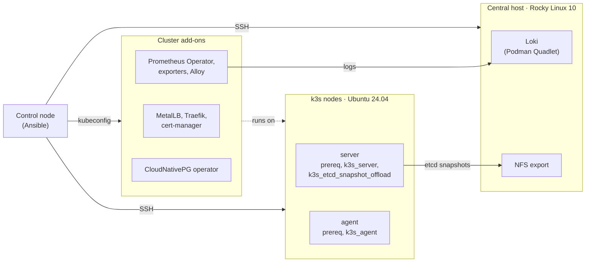

# homelab-platform

[](https://github.com/ziswb/homelab-platform/actions/workflows/ci.yml)
[](https://github.com/ziswb/homelab-platform/actions/workflows/gitleaks.yml)
[](LICENSE)

Ansible collection `ziswb.homelab_platform`: a **reference platform** for a small
k3s homelab. It is the architecture one homelab actually runs, written down as
roles and playbooks: k3s on small Ubuntu nodes, a central host running services
as Podman Quadlets, CloudNativePG for databases, a private CA with cert-manager,
Traefik and MetalLB for ingress, Prometheus Operator, Loki and Alloy for
monitoring. It is opinionated, not a general-purpose library; the decisions
behind it are documented as [ADRs](docs/adr/).



> **Status:** in production on the reference site: the k3s install, the nodes'
> trust in the private root CA, the central host's Podman base and Loki,
> cert-manager with the private CA chain, MetalLB and Traefik, the CloudNativePG
> operator, monitoring and log shipping, node maintenance (24 roles). The current
> release and what changed are in the [CHANGELOG](CHANGELOG.md).

## Supported

| | |
|---|---|
| k3s nodes (`server`, `agent`) | Ubuntu 24.04 LTS |
| Central host (`central_server`) | Rocky Linux 10 (RHEL 10 family) |
| Architectures | arm64, amd64 |
| Kubernetes | k3s only |
| Ansible | ansible-core 2.15 or later |
| Collections | `kubernetes.core` 6.x (>= 6.5.0); `community.general` 14.x; `ansible.posix` 2.x |

## Contracts

- **Inventory groups** are fixed: `server` (k3s control plane), `agent` (k3s
  workers), `central_server` (the central host). The roles and playbooks refer
  to these names.
- **Site values have no defaults.** The platform's own variables (`homelab_*`,
  e.g. the required `homelab_domain`) and every role's site inputs are required;
  each role declares them in `meta/argument_specs.yml`, so a missing one fails
  before anything runs. Versions and feature flags have defaults.
- **Secrets arrive as variables.** Roles never look secrets up themselves; your
  inventory resolves them (from a vault, a password manager lookup, ...).
- **Customize by composition.** Site-specific additions are your own roles or
  plays that run after the collection's; list-like inputs are
  `<role>_extra_*`, optional features `<role>_*_enabled`. Each Kubernetes
  resource is owned by exactly one role.

Details: [docs/variables.md](docs/variables.md) (the variable vocabulary),
[docs/bring-up.md](docs/bring-up.md) (the order a new site applies the
playbooks), [examples/inventory/](examples/inventory/) (an inventory skeleton).

## Roles

Each role has a README and an argument spec; each runs from its playbook
`ziswb.homelab_platform.<role>`, except the dependency-only `central_podman` and
`helm_preflight`. Two more playbooks combine roles: `k3s_cluster` (the nodes, servers
one at a time) and `monitoring` (the monitoring add-ons in fresh-cluster order).
Molecule covers what runs on a single host; the cluster add-ons are tested on the
reference site.

| Role | What it does | Molecule |
|---|---|---|
| **k3s nodes** (`server`, `agent`) | | |
| [prereq](roles/prereq/) | Prepares an Ubuntu 24.04 node for k3s | yes |
| [k3s_server](roles/k3s_server/) | k3s server with embedded etcd; optional registry mirrors | registry mirrors only |
| [k3s_agent](roles/k3s_agent/) | k3s agent; optional registry mirrors | registry mirrors only |
| [k3s_etcd_snapshot_offload](roles/k3s_etcd_snapshot_offload/) | Copies the servers' etcd snapshots to an NFS export on the central host |  |
| [homelab_root_ca_trust](roles/homelab_root_ca_trust/) | The nodes trust the private root CA (ADR-0007) | yes |
| [update_ubuntu](roles/update_ubuntu/) | Package upgrades, one node at a time, behind a cluster health gate | lookup logic, health gate script |
| [ssh_access](roles/ssh_access/) | SSH login by public key only, for one user (also on the central host) | yes |
| **Cluster** (from the control node, through the kubeconfig) | | |
| [k3s_upgrader](roles/k3s_upgrader/) | k3s upgrades by the system-upgrade-controller (ADR-0010) |  |
| [k3s_node_taints](roles/k3s_node_taints/) | Taints on existing nodes |  |
| [metallb](roles/metallb/) | MetalLB in L2 mode |  |
| [traefik_install](roles/traefik_install/) | Traefik ingress, its CRDs and the dashboard |  |
| [cert_manager](roles/cert_manager/) | cert-manager and the private CA chain |  |
| [cnpg_operator](roles/cnpg_operator/) | The CloudNativePG operator |  |
| [prometheus_operator](roles/prometheus_operator/) | prometheus-operator CRDs and operator |  |
| [kube_state_metrics](roles/kube_state_metrics/) | kube-state-metrics |  |
| [node_exporter](roles/node_exporter/) | node-exporter on every node |  |
| [pushgateway](roles/pushgateway/) | Prometheus Pushgateway |  |
| [kubelet](roles/kubelet/) | ServiceMonitor for the kubelet |  |
| [traefik_service_monitor](roles/traefik_service_monitor/) | ServiceMonitor for Traefik |  |
| [alloy](roles/alloy/) | Grafana Alloy: every pod's log to Loki |  |
| [helm_preflight](roles/helm_preflight/) | Checks the helm version before any chart task (dependency only) |  |
| **Central host** (`central_server`) | | |
| [central_podman](roles/central_podman/) | Podman for rootful Quadlets, with a post-update smoke test (dependency only) | yes |
| [central_loki](roles/central_loki/) | Grafana Loki as a Podman Quadlet |  |
| [central_os_updates](roles/central_os_updates/) | Automatic package updates without reboots (ADR-0013) |  |

## Install

There is no Galaxy release; install a tagged version from git:

```yaml
# requirements.yml
collections:
  - name: https://github.com/ziswb/homelab-platform.git
    type: git
    version: v1.7.3   # the latest vX.Y.Z tag, see CHANGELOG.md
```

```bash
ansible-galaxy collection install -r requirements.yml
```

Releases follow [SemVer](https://semver.org/): a new required variable, a
renamed variable or a changed inventory group is a major release.

## Development

CI (`.github/workflows/ci.yml`) runs on every push and PR:

- **Tier 1:** yamllint, ansible-lint (production profile), a structure check
  (`scripts/check-structure.py`: README and argument specs per role, Docker-only
  Molecule), the collection build, and `--syntax-check` of every playbook
  against the example inventory.
- **Tier 2:** Molecule scenarios in `extensions/molecule/`, Docker driver, on
  systemd test images (Ubuntu 24.04 for node roles, Rocky Linux 10 for central
  host roles).

Locally:

```bash
python3 -m venv .venv && .venv/bin/pip install -r .github/requirements-ci.txt
. .venv/bin/activate
# A project-local collections path: nothing goes into ~/.ansible.
export ANSIBLE_COLLECTIONS_PATH="$PWD/.cache/collections"
ansible-galaxy collection build --force --output-path .cache
ansible-galaxy collection install --force .cache/ziswb-homelab_platform-*.tar.gz
ansible-galaxy collection install -r extensions/molecule/requirements.yml

yamllint --strict . && ansible-lint --strict && scripts/check-structure.py
scripts/molecule-images.sh
molecule test -s platform_smoke
```

With a Docker context other than the default socket (Rancher Desktop, Colima),
set `DOCKER_HOST=$(docker context inspect --format '{{.Endpoints.docker.Host}}')`
for Molecule.

### Vendored manifests

Upstream release YAML in `roles/*/files/` changes only through
`scripts/refresh-vendored.sh <component> <version>` (ADR-0012): it downloads the
release, makes the checked edits, writes the version header and updates NOTICE.
Run without arguments for the component list.

## Public code, private configuration

This collection was extracted from the private infrastructure repository that
runs the reference site. That repository pins a release tag of this collection
and holds everything site-specific: the inventory, group_vars, secrets, and the
site's own roles. None of it is in here; site values appear only as required
variables or as placeholders such as `<domain>` or `<central-host>`, and a leak
guard (gitleaks and a private blocklist, as git hooks and in CI) keeps it that
way.

- **Fresh history.** The history here starts at the extraction. Roles moved in
  one at a time with a zero-diff check: the consuming site rendered the same
  result before and after the move, and improvements waited for a later release
  (the collection rules in [CLAUDE.md](CLAUDE.md)).
  ADRs marked "Originally: infrastructure ADR-NNNN" moved here with the roles
  they constrain.
- **What runs on it.** Among others,
  [PVLogger](https://github.com/ziswb/pvlogger-msa), a monitoring system for a
  home photovoltaic installation.
- **AI-assisted.** Much of the work was done with Claude Code as a pair
  programmer; [CLAUDE.md](CLAUDE.md) holds its project instructions, and the
  commits it co-wrote say so in a `Co-Authored-By` trailer.

## Security

See [SECURITY.md](.github/SECURITY.md).

## License

[Apache License 2.0](LICENSE). Vendored upstream manifests and charts keep their
own licenses, listed in [NOTICE](NOTICE).
